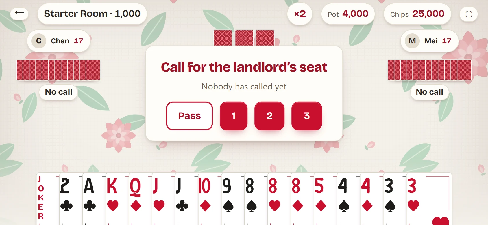

<div align="center">


# Card Games

**Dou Di Zhu, Big Two, Blackjack and Texas Hold'em against bots, in the browser.**<br>
Installs as an app, runs offline, and has no build step and no dependencies.

[](https://josephting1105123.github.io/Card-Games/)

[](https://github.com/josephting1105123/Card-Games/actions/workflows/ci.yml)


[](LICENSE)

[Design notes](docs/DESIGN.md) · [Hosting](docs/HOSTING.md)

<br>



</div>

Open the link on a phone and add it to your home screen. It installs like an app, opens full screen in landscape, and runs with no signal at all.

The whole app is ES modules served as-is. That's why it installs straight from GitHub Pages, and why the local multiplayer host is a single `node` command with nothing to install first.

## Games

| Game | Status |
| --- | --- |
| **Dou Di Zhu** 斗地主 | Single player and local multiplayer |
| **Big Two** 锄大地 | Single player |
| **Blackjack** (American and Malaysian Ban Luck) | Single player |
| **Texas Hold'em** | Single player against five bots, and online rooms |
| Niu Niu 牛牛 | Planned |

The Dou Di Zhu bots come in seven strengths, from Novice to Grandmaster, one per table. They see only what a player at that seat would see: a stronger bot judges better, it never gets more information. Each game keeps its own Elo rating. The win rates, the chip economy and the loss caps are measured and explained in the [design notes](docs/DESIGN.md).

## Run it locally

```bash
npm test                  # the test suite, node:test, nothing to install
node server/server.js     # http://localhost:8787, also hosts local multiplayer
PORT=9000 node server/server.js
```

Any static server works too. The table is dealt across, so it wants landscape: on a phone in portrait the app says so rather than squashing the fan.

## Local multiplayer

Everyone on the same Wi-Fi, joined by a five-character code. One machine hosts:

```bash
node server/server.js
```

It prints a `http://192.168.x.x:8787` address. Everyone opens that address, picks **Local multiplayer → Join room**, and types the code the host reads out. The host sets the pot, the starting stack, the base multiplier, the hand ceiling and how many of the three seats people take. Bots fill the rest.

The host is authoritative: it shuffles, runs the bots, validates every move against the same rules module the browser uses, and sends each seat only that seat's hand. If someone drops mid-hand, a bot takes the seat so the table doesn't stall.

- **The host serves the app as well as the rooms.** A page loaded from GitHub Pages over HTTPS isn't allowed by the browser to open a plain `ws://` connection to a private address, so LAN play needs everyone on the host's own address. The GitHub Pages copy plays through the online server instead ([hosting notes](docs/HOSTING.md#online-play)).
- **A room deals its own coins.** Single player is a persistent purse of chips with an Elo attached. A room's money is temporary: dealt out when the room opens, gone when it closes, never touching anyone's purse. The host picks **silver** for a quick game (a pot of 10) or **gold** for a heavy one (a pot of 1,000). The stack follows the pot at 25× until the host types a stack of their own.
- **Nothing here stands for real money.** There are no real currencies in the app, no payments, no transfers, and no way to move a balance off the device. A test keeps it that way.

The WebSocket server is written here (`server/ws.js`, about 230 lines) rather than pulled from npm, so hosting needs no install and there's no dependency tree to audit.

## Rules

<details>
<summary><b>Dou Di Zhu</b> 斗地主</summary>

The default ("classic") rule set, no house variations.

- 54 cards, three players, 17 each, three face down for the landlord.
- `3 < 4 < … < K < A < 2 < small joker < big joker`.
- Bidding: in turn each player calls 1, 2 or 3 points or passes. A call must beat the standing call, a call of 3 ends bidding at once, and three passes redeal.
- The landlord takes the three face-down cards (20 in hand) and leads.
- Combinations: single, pair, trio, trio with a single or a pair, straight of five or more, three or more consecutive pairs, aeroplanes (consecutive trios, with single or pair wings), four with two, bombs, and the rocket. Chains may not pass the ace: 2s and jokers never join one.
- A bomb beats anything but a higher bomb or the rocket. The rocket beats everything.
- Stake multiplier = points called × 2 per bomb or rocket × 2 for a spring (landlord wins with neither farmer having played) or an anti-spring (farmers win and the landlord played only the opening hand).

</details>

<details>
<summary><b>Big Two</b> 锄大地</summary>

52 cards, no jokers, four players, 13 each. No bidding and no bottom cards: everyone plays their own hand from the deal.

- `3 < 4 < … < K < A < 2`; suits only ever break a tie, ranked `♦ < ♣ < ♥ < ♠`.
- Whoever holds the 3♦ leads the first trick and must include it in that lead.
- Combinations: single, pair, triple, or a five-card hand. Big Two has no four-card play of its own. Five-card hands rank straight < flush < full house < four of a kind (plus one kicker) < straight flush, regardless of the ranks involved, and ties within a type fall back to suit.
- Turns go counter-clockwise from you: right, then across, then left. Three passes in a row clear the trick back to whoever is still standing, who leads next with anything they choose.
- A hand ends the instant a seat empties. Every seat still holding cards pays the winner `cards left × rate`, where rate is the table's pot ÷ 10, flat, with no multiplier.

</details>

## Project layout

```
index.html              app shell
sw.js                   service worker: precache everything, run offline
                        (its cache name is a hash of what it caches, stamped by
                        tools/stamp-sw.mjs and checked by the tests)
manifest.webmanifest    PWA manifest (installs landscape)
styles/tokens.css       palette, type scale, motion, elevation — the only :root
src/core/               cards, seeded RNG, Elo, chips and lobbies, coins, profile
src/games/              rules, move generation, engine, bot, match runner per game
src/ui/                 card art, table view, screens, game controllers
src/net/                room codes, wire protocol, LAN client
server/                 static + WebSocket host, rooms, LAN addresses
assets/fonts/           Bricolage Grotesque, self-hosted (OFL)
assets/textures/        the tablecloth print
tools/                  icon generator, bot simulator
test/                   node:test, no runner to install
```

`src/games/**` and `src/core/**` never touch the DOM, because the LAN host imports the same files. A test enforces it.

## Tests

```bash
npm test                       # everything
node --test test/rules.test.js
node tools/sim.mjs 3000        # bot ladder report
```

The suite covers every combination type and rejection, the beats relation, move generation, bidding, turn order, springs, deck conservation over 100 bot games, the two loss ceilings and the bankruptcy cycle, Elo, coin formatting and the absence of any real currency, room codes, the WebSocket handshake and framing, a full two-client LAN hand over a real socket, chip conservation when caps bite, a client vanishing without a close frame, and the offline manifest. It also checks that no module imports a Node built-in into the browser, that headings use the right typeface, and that no design token is defined outside `tokens.css`.

## License

MIT. See [LICENSE](LICENSE).
